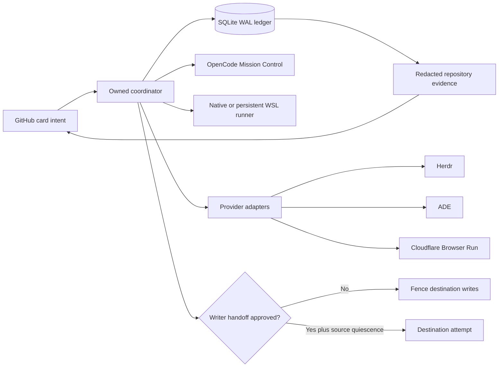

# Super-SpecKit V2 change story

GitHub owns card intent; repository ADRs and tests own technical truth; the coordinator alone writes runtime state. Provider adapters never become competing ledgers. Writer transfer requires a frozen capsule, source quiescence, and explicit approval for that exact capsule. Local tests prove these boundaries, while live Herdr, ADE, Cloudflare, Windows/WSL, and `whitelabels-cex` journeys remain release gates.
