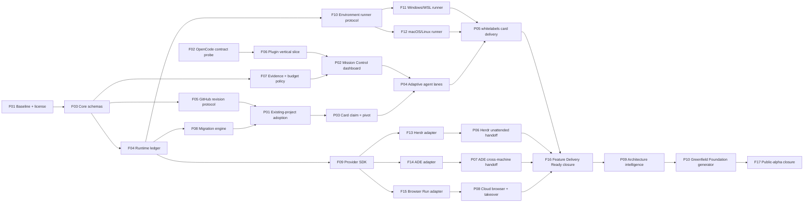

# Super-SpecKit V2 Foundation and Feature card graph

Status: draft, ready to translate into GitHub Issues after owner approval. Estimates are deliberately omitted until the team validates the first card; each card is one independently verifiable outcome, not a list of files.

## Dependency graph

## Foundation cards

| ID | Outcome | Depends on | Acceptance summary |
| --- | --- | --- | --- |
| F01 | Freeze V1 behavior, source/license inventory and alpha authority boundary | — | Reproducible baseline; candidate licensing report; existing dirty work preserved |
| F02 | Pin and probe one OpenCode V2 plugin contract | — | Server/TUI/RPC fixture identifies supported/degraded/unavailable APIs |
| F03 | Publish versioned CardRef, Attempt, Lease, Checkpoint, Artifact, Evidence, Handoff and Capability schemas | F01 | Positive/negative fixtures; no credential-bearing fields |
| F04 | Implement atomic runtime ledger with fencing, cancellation and recovery | F03 | Stale writer, duplicate completion, expiry and cancel-unknown tests pass |
| F05 | Define GitHub field ownership and immutable card revision activation | F03 | Pivot fixture fences old attempt and invalidates affected proof |
| F06 | Deliver installable OpenCode server/TUI/RPC vertical slice | F02, F04 | Active fixture survives client close/reconnect and renders state |
| F07 | Deliver repository-safe evidence, budget and telemetry policy | F03 | Raw sensitive artifact rejected from Git; failed-but-accepted remains distinct |
| F08 | Migrate and roll back V1 state without rewriting history | F04, F07 | Preview, backup, digest, rollback and idempotent rerun proven |
| F09 | Publish provider adapter contract and conformance harness | F04 | Fake provider proves start/observe/checkpoint/interrupt/evidence/release semantics |
| F10 | Deliver provider-neutral environment-runner protocol | F04 | Structured command, process ownership, cleanup and streaming tests pass |
| F11 | Deliver persistent Windows/WSL runner with native worktrees | F10 | Clean Windows 11/WSL run avoids per-command bridge and preserves unrelated resources |
| F12 | Deliver native macOS/Linux runner and container-engine discovery | F10 | Same reference fixture passes with supported engine and degraded explanation |
| F13 | Deliver Herdr adapter | F09, F10 | Warm process, agent pane, SSH and interruption recovery fixture passes |
| F14 | Deliver external ADE adapter with reviewed license boundary | F09, F10 | Lane/proof/handoff fixture passes without ADE becoming canonical |
| F15 | Deliver Cloudflare Browser Run provider and protected preview | F09, F07 | Guardrails, synthetic auth, recording, budget, cleanup and session replacement pass |
| F16 | Independently close Feature Delivery Ready | P05, P06, P07, P08 | Fresh operator can import, run, hand off, verify and continue real work |
| F17 | Independently close public-alpha evidence | P10 | AC-12 proof pack, accessibility/security/license/install/upgrade review pass |

## Feature cards

| ID | User-visible outcome | Depends on | Acceptance summary |
| --- | --- | --- | --- |
| P01 | Adopt `whitelabels-cex` and show a truthful migration/import preview | F05, F08 | Foundation, cards, branches, decisions and drift visible without mutation |
| P02 | Open Mission Control and understand project, environment, agents and proof immediately | F06, F07 | Keyboard-first dashboard, quiet notifications and accessible text equivalents |
| P03 | Claim a GitHub card and react safely to a mid-run pivot | P01, F04 | Fenced lease/worktree; revision acknowledgement and stale-proof behavior proven |
| P04 | Run the smallest useful permanent-role team across independent lanes | P02, P03, F09 | One coupled writer; parallel independent cards; cost/time metrics visible |
| P05 | Complete three real `whitelabels-cex` card shapes across macOS and Windows/WSL | P04, F11, F12 | Backend/data, UI/browser and integration/infra cards meet exact-candidate proof |
| P06 | Continue an unattended card through Herdr after UI disconnect/interruption | F13, P03 | Card identity, warm environment and checkpoint survive; no duplicate writer |
| P07 | Move a card between owned machines through ADE | F14, P03 | Idempotent handoff and ambiguous acknowledgement recovery proven |
| P08 | Test a headless-server web feature in Cloudflare with human takeover | F15, P02 | Live View takeover/handback, recording descriptor and protected-route cleanup pass |
| P09 | Research and decide architecture using current evidence and principal-level review | F16 | Quality scenarios, alternatives, threat/operability review and owner decisions produce ADRs |
| P10 | Create a greenfield Foundation graph and walking skeleton, then re-import it | P09 | Universal/domain/project cards publish to GitHub and reach Feature Delivery Ready |

## Parallel work plan

After F03, a 2–4-person team can run these lanes without shared mutable ownership:

- Runtime lane: F04 → F09/F10.
- Portfolio/migration lane: F05 → F08 → P01/P03.
- Evidence/policy lane: F07 → dashboard and provider proof support.
- OpenCode experience lane: F02 → F06 → P02.

Provider adapters F13–F15 are independent after F09/F10. Platform runners F11 and F12 are independent after F10. Integration cards meet only through published schemas and conformance tests.

## GitHub publication contract

Each issue should include:

- Type: Foundation or Feature.
- Contract revision and source decision links.
- Outcome and explicit non-goals.
- Dependencies as native blocked-by edges.
- Architecture risk retired or user outcome delivered.
- Public seams and required evidence.
- Supported/degraded provider behavior.
- Security/data classification.
- Completion and rollback/recovery conditions.

Project fields should include Phase, Type, Capability, Risk, Active Harness, Evidence state, Contract revision and Lease owner/expiry. The issue remains the work identity; a Project item is its portfolio projection.
