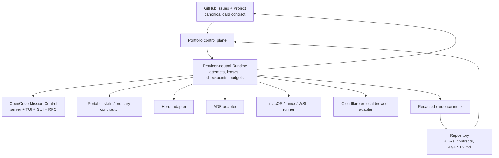
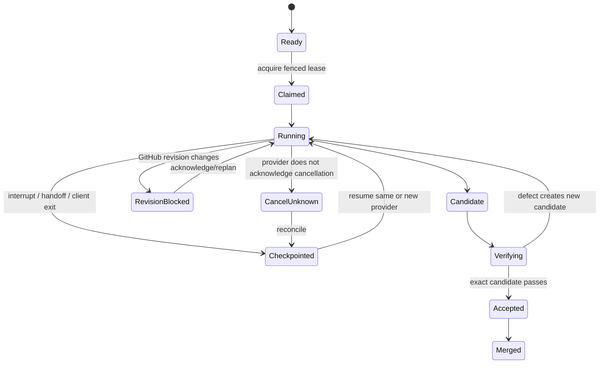

# Super-SpecKit V2 system architecture

Status: draft. This document defines boundaries and contracts, not implementation authority.

## Architecture thesis

Super-SpecKit V2 is one open, provider-neutral engineering protocol with progressive host enhancement. GitHub owns collaborative work intent. Repository files own versioned technical truth. Super-SpecKit owns safe execution and evidence contracts. Harnesses, models, terminals, browsers and remote workers are replaceable attempt providers.



## Authority by field

| Concern | Canonical authority | Projection/cache |
| --- | --- | --- |
| Card identity, active revision, priority, status, assignee, dependencies | GitHub Issue/Project | `.super-speckit/portfolio/` |
| Domain language, architecture, contracts and working agreements | Git repository at commit | Mission Control index |
| Code behavior | Code and executable tests | Diagrams/summaries |
| Active lease, attempt, cancellation and live budget | Runtime ledger | GitHub status and safe checkpoint |
| Candidate identity | Git commit SHA | Card/attempt record |
| Acceptance evidence | Typed receipt bound to card revision, candidate and environment | Git-safe descriptor; raw artifact external when sensitive |
| Provider session | Provider itself | Opaque adapter reference in attempt |
| Credentials | OS/provider secret store | Logical secret handle only |

GitHub is the source of truth for task changes and pivots. A GitHub contract activation produces an immutable revision fingerprint. An already-running attempt remains bound to its consumed revision until it acknowledges the new one. Repository contracts may elaborate a card but cannot silently override it.

## Logical components

### Method core

Portable, inspectable instructions and policies: architecture research, principal architecture, Portfolio/Foundation generation, implementation, verification, release, incident learning and self-improvement. It must work without Mission Control.

### Portfolio

Imports or creates initiative/spec/card structures, runs Product Owner grilling, stores card revision fingerprints, computes the unblocked frontier, distinguishes Foundation and Feature cards, and renders two gates:

- **Feature Delivery Ready:** the walking skeleton and delivery runway are independently reproducible.
- **Production Release Ready:** real integrations, hosting, security, promotion, rollback, observability and operations are proven.

### Runtime ledger

The concurrency and recovery authority. It may be local SQLite or an equivalent transactional store in V1, with repository-safe checkpoints and GitHub projections. A hosted implementation may arrive later without changing contracts.

Core records:

```text
CardRef       repository + issue node ID + revision fingerprint
Attempt       provider + session + card revision + workspace + budgets + state
Lease         owner + workspace + fencing token + heartbeat + expiry
Checkpoint    candidate/dirty digest + completed criteria + next action
Artifact      kind + hash + producer + sensitivity + locator + retention
Evidence      criterion + candidate + environment + outcome + artifact refs
Handoff       source attempt + frozen checkpoint + destination + acknowledgement
Capability    provider/host versions + supported/degraded/unavailable reasons
```

All updates use optimistic revision checks. An expired or superseded lease cannot write. Read-only reviewers do not receive a writer lease.

### Scheduler and permanent roles

The UI always exposes Coordinator, Architect, Researcher, Builder, Verifier, Browser Specialist and Release Operator roles. Sessions are card-scoped and created only when useful. The scheduler activates the smallest team that can reduce wall time without shared mutable ownership.

- One coupled card: one Builder, then independent Verifier.
- Independent cards: isolated worktrees and parallel Builders.
- Architecture decision: Researcher and Architect may run concurrently.
- UI acceptance: Browser Specialist starts after a candidate exists; the Builder may use a separate feedback browser earlier.

### Environment runner

One elected owner per worktree and port namespace. It discovers capabilities, creates native worktrees, keeps Docker and watchers warm, executes structured commands, streams progress, and cleans only resources with matching ownership receipts.

- macOS/Linux: native supervised runner and discovered container engine.
- Windows: OpenCode UI may run on Windows while one long-lived runner executes inside WSL on a WSL-native managed worktree.
- Remote SSH: provider adapter connects to an owned runner; source truth remains Git/GitHub.

### OpenCode Mission Control

A multi-part plugin using a pinned and capability-probed OpenCode V2 contract:

- server: tools, hooks, agents, sessions, events, permissions and RPC;
- TUI: keyboard-first project/card/agent/environment/evidence views;
- GUI: later richer visual panels over the same RPC;
- background service: active runs continue after clients close.

Mission Control is a projection of Runtime state, never a competing ledger.

### Provider adapters

Each provider implements the same lifecycle:

```text
probeCapabilities → score → start → observe → checkpoint
→ send → interrupt → collectEvidence → release
```

- Herdr: terminal/process persistence, warm Docker, worktrees, panes and SSH machines.
- ADE: Brain, lanes, automations, proof, mobile access and cross-machine handoff. It remains an external AGPL peer.
- Cloudflare Browser Run: replaceable headless Chrome sessions, Live View, human takeover, recordings and guarded web access. It is not a coding or desktop-computer-use runtime.
- Portable contributor: GitHub/branch/PR/CI is treated as an external attempt that can be imported.

## State flow



## Security and privacy

- `.super-speckit/` is safe to commit: no tokens, private keys, raw customer payloads, private recordings, or unredacted terminal transcripts.
- Secret handles resolve only at the execution provider. Workers receive least privilege and bounded network access.
- Raw artifacts default outside Git. Committed descriptors include digest, producer, sensitivity, retention and access-controlled locator.
- Cloudflare Browser Run uses temporary authenticated previews, synthetic accounts, hostname guardrails, short expiry and visible external-exposure state.
- Provider permissions are not considered a sandbox. Workspace, process, network and destructive-action ownership are enforced separately.
- Local metrics remain local by default. Outbound anonymous telemetry is opt-in and inspectable.

## Failure and recovery invariants

- A card revision change cannot reuse evidence silently.
- A timeout is not proof that a process stopped.
- Cancellation completes only after owned child processes acknowledge or enter `cancel_unknown`.
- Dirty worktrees are preserved when ownership or cleanup safety is ambiguous.
- A browser or container session may disappear; Git commits, checkpoints and artifact descriptors are the recovery path.
- Failed-but-authorized evidence remains failed; risk acceptance is a separate decision.
- Feature Delivery Ready never implies Production Release Ready.

## Deployment modes

1. Portable only: skills, GitHub, Git, tests and CI.
2. OpenCode local: Mission Control and supervised local runner.
3. OpenCode + Herdr: persistent terminals and warm environments.
4. OpenCode + ADE: lanes, Brain, automation, proof and cross-machine access.
5. Any local mode + Cloudflare Browser Run: remote web verification.
6. Hosted continuation later: durable coordinator plus replaceable workers; not V1.

## Compatibility and migration

V2 adds versioned projections rather than rewriting historical V1 artifacts. Migration is previewable, backed up, idempotent and digest-checked. Existing portable skills and CLI remain valid. Host wrappers are repaired across `.agents`, `.codex`, `.claude`, `.cursor`, `.opencode`, `.pi` and `.zcode` project roots.
